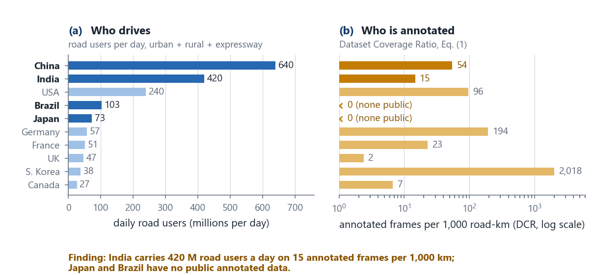
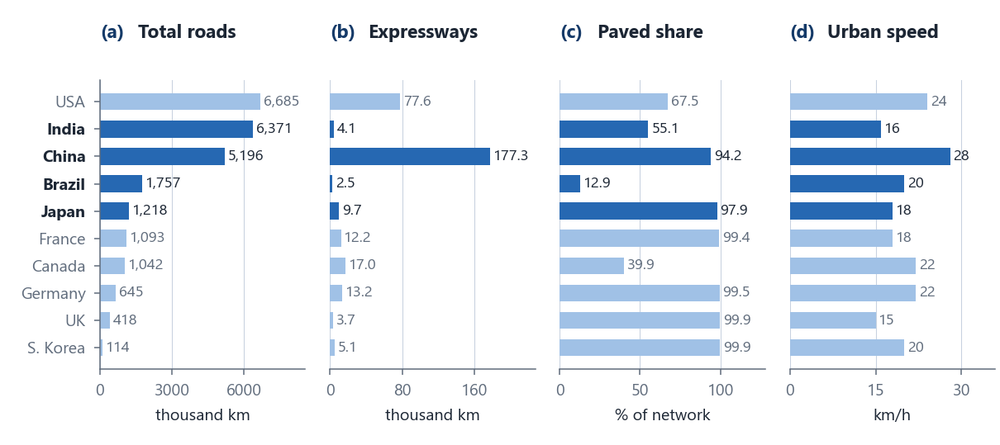
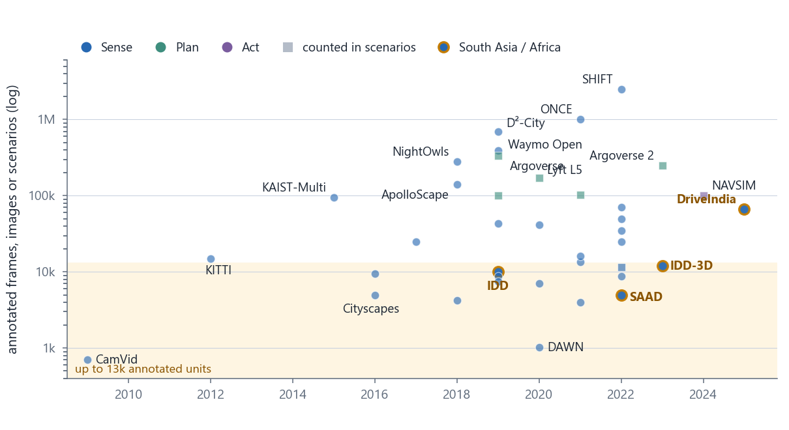
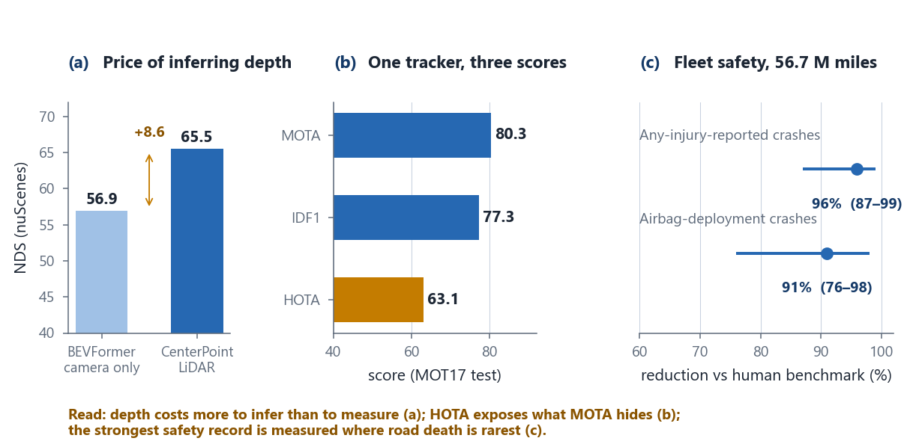
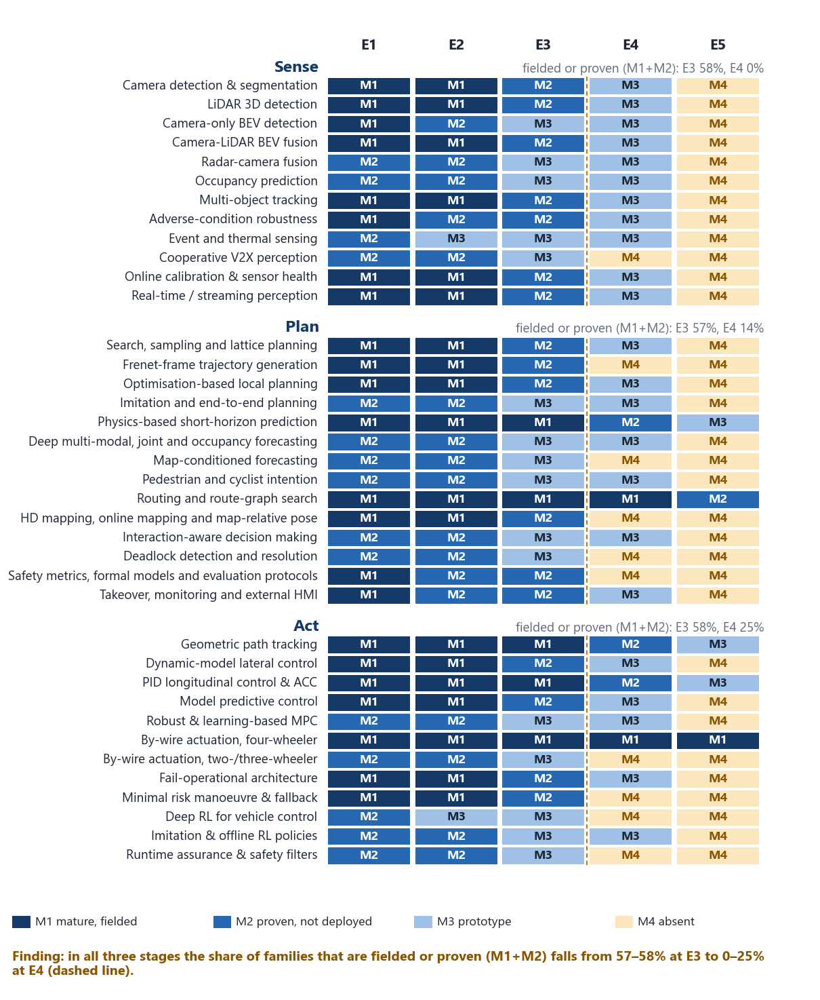
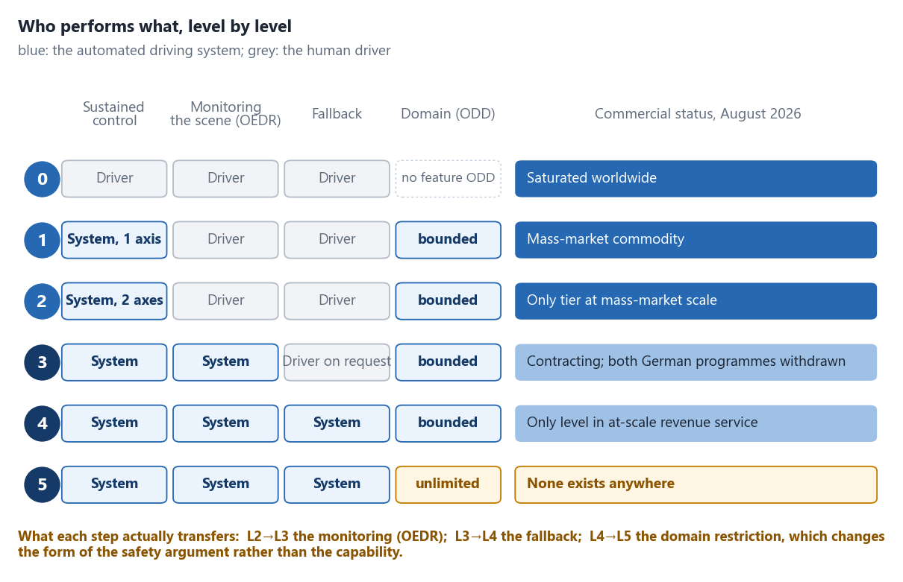

# Autonomous Driving Survey

**Building towards Level-5 Vehicular Autonomy: A Comprehensive Survey to Assess Global Readiness in Data, Technology, and Society**

Swarnendu Ghosh, Utathya Aich, Branko Šter. Under preparation for ACM Computing Surveys.

This repository holds the survey's reference list and the plots built from its data. Every number in a plot is computed by a script in [`scripts/`](scripts), from values stated in the paper.

## Headline finding

Road users and annotated data are distributed in opposite ways. India carries about 420 million road users a day and has about 15 annotated frames per 1,000 road-km. Japan and Brazil have no public annotated benchmark of record. South Korea, with 38 million daily users, has about 2,018.



*(a) Daily road users, summed over the urban, rural and expressway columns of the road-network table. (b) Dataset Coverage Ratio (DCR) = annotated frames per 1,000 road-km, log scale. Blue is published data, amber is our metric.*

Browse the reference list and plots as a site: https://utathyaworks.github.io/Autonomous_Driving_Survey/ (table, cards, timeline and plots views).

## Plots

| Plot | What it shows |
|---|---|
| [`data_inversion`](figures/data_inversion.png) | Road users per day against Dataset Coverage Ratio, ten largest economies |
| [`data_roads`](figures/data_roads.png) | Total roads, expressways, paved share and urban speed for the same ten economies |
| [`data_landscape`](figures/data_landscape.png) | 38 benchmark datasets by release year and annotated size; South Asian and African datasets ringed |
| [`maturity_heatmap`](figures/maturity_heatmap.png) | All 38 method families (12 Sense, 14 Plan, 12 Act) graded M1 to M4 at on-road entropy E1 to E5; the share fielded or proven falls from 57-58% at E3 to 0-25% at E4 |
| [`sae_ladder`](figures/sae_ladder.png) | Who performs control, monitoring and fallback at each SAE level, with commercial status |
| [`quant_results`](figures/quant_results.png) | Headline results quoted in the metrics section: camera against LiDAR detection, one tracker under three metrics, Waymo crash-rate reductions with intervals |











Vector PDFs of every plot are in [`figures/`](figures).

## Papers

[`PAPERS.md`](PAPERS.md) lists all 462 unique references (278 general, 36 Sense, 76 Plan, 72 Act), sorted by year, with venue and DOI or URL where the BibTeX entry has one. The source BibTeX files are in [`data/`](data).

## Reproduce

```bash
pip install matplotlib numpy
python scripts/fig_data.py
python scripts/fig_quant.py
python scripts/fig_maturity.py
python scripts/fig_sae.py
python scripts/make_paper_list.py
```

Colour code, as in the paper: blue marks other people's published work, amber marks our own analysis. Plots stay legible in greyscale.

## Status

Review draft. The manuscript source is not part of this repository.
